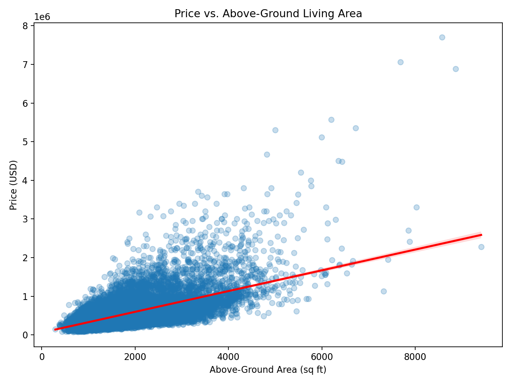
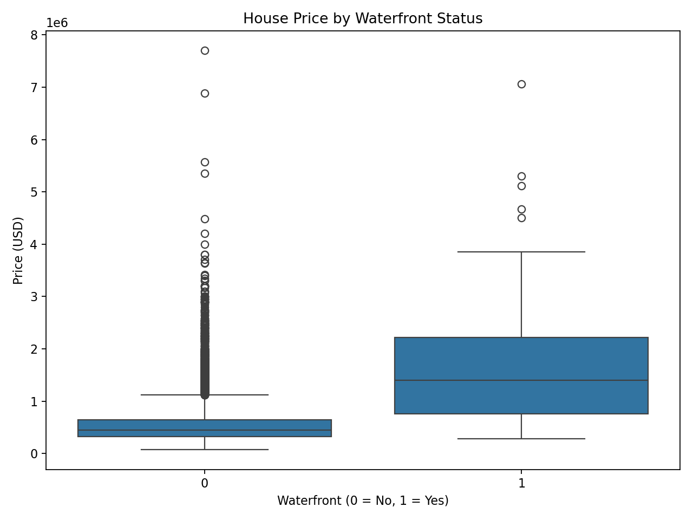

# PENG YUANYUAN
## Data Science Learning Portfolio

I am a student studying data science and data visualization in CISC7204. This portfolio presents a completed course analysis and documents its methods, findings, limitations and next improvements.

### Technical skills practiced
Python · pandas · NumPy · Matplotlib · Seaborn · scikit-learn · exploratory data analysis · regression · model evaluation

## House Price Analysis in King County, USA
**Research question:** How are house characteristics associated with sale prices, and how well can regression models predict those prices?

**Status:** Completed coursework; portfolio published and updated after feedback.

The project analyzes 21,613 house sale records from May 2014 to May 2015. It combines data cleaning, visual exploration and linear, polynomial and Ridge regression.

<aside style="border-left:4px solid #26749b;background:#eef6fa;padding:16px 20px;margin:24px 0;" aria-label="Key Takeaways">
<h3 style="margin-top:0;">Key Takeaways</h3>
<ul>
<li><strong>Strongest finding:</strong> Above-ground living area is positively associated with house price (Pearson r ≈ 0.606).</li>
<li><strong>Best test result:</strong> Of the two models evaluated on the same test set, polynomial Ridge achieved the higher R², approximately 0.700. This describes explained variation, not prediction accuracy.</li>
<li><strong>Main limitation:</strong> Missing values were imputed before the train/test split, allowing test-set information into preprocessing.</li>
</ul>
</aside>

Above-ground living area is positively associated with price (Pearson r ≈ 0.606). The spread shows that area alone cannot account for every price difference.

The boxplots summarize differences in price distributions. Unequal group sizes mean absolute outlier counts should not be interpreted as outlier rates.

The completed assignment reports test R² of approximately 0.648 for Ridge regression and 0.700 for polynomial Ridge. These are explained-variation measures, not prediction accuracy percentages.

**Limitation:** The original assignment fills missing values before splitting the data. My next improvement is to move imputation into a training-only pipeline and evaluate prediction errors and residuals. The historical, single-region data also limits wider generalization.

[View the reproducible project repository](https://github.com/Pengyuanyuanmo/data-science-project)

[View the original project and notebook](https://github.com/Pengyuanyuanmo/CISC7204-MC663623-2026GitHub/tree/main/Module06)

The project is based on an IBM Skills Network course notebook. AI assistance helped prepare this portfolio adaptation. Feedback received: add a short Key Takeaways box so readers can identify the strongest finding, best model result and main limitation at a glance. The box above implements this suggestion.
